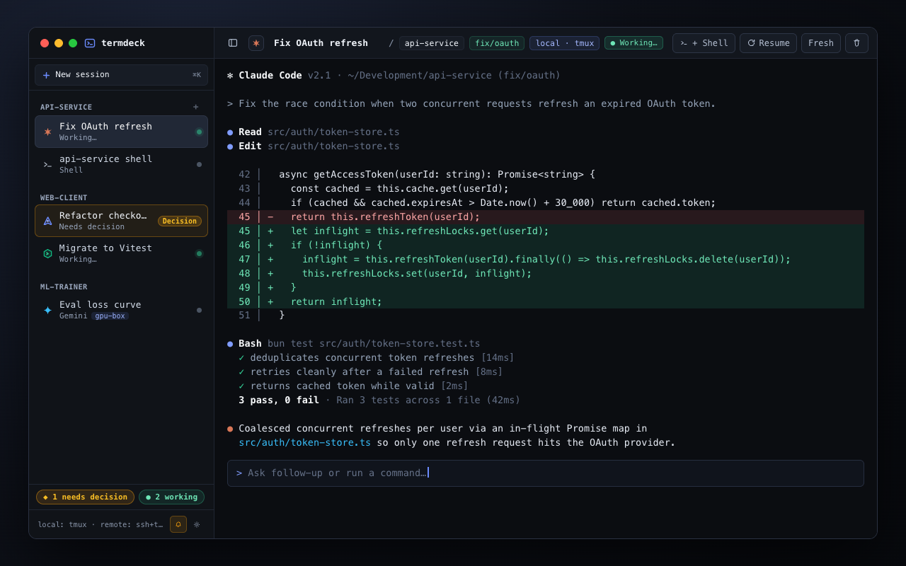

# termdeck

A minimal, zero-injection desktop and web UI for your local and remote coding agent terminals (`xterm.js` + session sidebar + persistent resume).



## Features

- **Zero prompt/tool injection** — runs real `claude`, `agy` (Antigravity), `codex`, `gemini`, or plain `$SHELL` inside a real PTY with clickable URL & OSC 8 `file://` links.
- **Always resuming** — remembers every session's directory, host, agent, and UUID in `~/.termdeck/sessions.json` and auto-discovers existing Claude, Antigravity, and Codex conversations in a folder.
  - Uses `tmux -L termdeck` automatically when `tmux` is installed (locally or on remote SSH hosts) so sessions survive restarts and network drops.
  - Works out of the box without `tmux` via Bun's native PTY + scrollback replay + native CLI `--resume` / `--continue` flags.
- **Clean sidebar & compact header** — sessions grouped by project or custom group with drag-and-drop reordering, agent icons, live `Working` / `Done` / `Decision` indicators, git branch pill, inline title & group rename, `+ Shell` companion button, `⌘K` quick launcher, and `⌘,` settings (persisted in `~/.termdeck/config.json`).
- **Native macOS notifications** — independent toggles for desktop banners, Dock icon badge count, and Dock bounce, plus per-event controls (permission/decision prompts, finished turns, session exits, terminal bell) and an optional `/api/hooks/:id` webhook endpoint.
- **Remote over SSH, VPN mobile UI, & thin-client mode** — auto-discovers hosts from `~/.ssh/config`, includes a live-toggleable **Remote / VPN Access** listener with token auth, mobile slide-over drawer + touch quick-key bar, and lets your MacBook desktop app connect directly to an always-on Mac mini / server.

---

## Quick Start

Requires [Bun](https://bun.sh/) (`>= 1.4` for native `Bun.Terminal` PTY support).

```bash
bun install
bun run start
```

This launches the native Electron desktop app (with integrated macOS titlebar and native notifications).

### Browser-only / Headless mode

```bash
bun run web
# Open http://127.0.0.1:3434
```

### Build standalone macOS `.app` bundle

```bash
bun run build:app
# Installs /Applications/termdeck.app
```

---

## Always-On Mac mini + MacBook + Phone Setup

Run `termdeck` 24/7 on a Mac mini (or Linux server) and share one live session list across your MacBook desktop app and your phone over VPN (WireGuard / Tailscale):

### 1. On the Mac mini (server)

Install `tmux` so sessions survive server restarts too:

```bash
brew install tmux
```

Start `termdeck` in headless web mode (or leave `termdeck.app` running with **Settings → Remote / VPN Access → Keep Mac awake on AC** enabled):

```bash
bun run web
```

Open `http://127.0.0.1:3434` once on the Mac mini, go to **Settings (`⌘,`) → Remote / VPN Access**, enable **Allow phone / VPN access**, and copy the generated **VPN** URL (`http://<vpn-ip>:3434/?token=...`).

*(Optional)* To start `termdeck` automatically on boot on macOS, add a `launchd` LaunchAgent at `~/Library/LaunchAgents/com.local.termdeck.plist` running `bun run web` in your `termdeck` directory.

### 2. On your MacBook (thin-client desktop app)

Open `termdeck.app` on your MacBook:

1. Open **Settings (`⌘,`) → Desktop Server**.
2. Paste the Mac mini URL (`http://<vpn-ip>:3434/?token=...`) and click **Connect**.
   - Alternatively, launch with `TERMDECK_SERVER_URL=http://<vpn-ip>:3434/?token=...`.
3. Your MacBook app now displays the Mac mini's live sessions with full native macOS notifications, Dock badges, and keyboard shortcuts — without starting a local backend.
4. To switch back anytime, click **Use Local** in Settings or **View → Switch to Local Server** in the menu bar.

### 3. On your Phone (over VPN)

Open the same copied URL (`http://<vpn-ip>:3434/?token=...`) in Safari or Chrome on your phone:

- The token sets a 30-day `HttpOnly` cookie and is stripped from the address bar.
- Tap the sidebar icon for the slide-over session drawer, and use the bottom touch quick-key bar (`Esc`, `Tab`, `↑`, `↓`, `1`, `2`, `^C`, `Enter`, `End`) to approve prompts without dismissing the keyboard.
- Tip: Use **Add to Home Screen** on iOS/Android for a full-screen app experience.

---

## Remote Sessions Over SSH

To run agents directly on remote machines from your local `termdeck`:

1. Add hosts to `~/.ssh/config` (e.g. `Host devbox`).
2. Press **`⌘K`** → choose the host in **Machine** → pick the remote directory.
3. `termdeck` connects with `ssh -tt -o ControlMaster=auto` and attaches to `tmux -L termdeck` on the remote host (falling back to a direct shell if `tmux` isn't installed).

---

## Notifications & Deterministic Hooks

`termdeck` automatically detects permission/decision prompts and turn completion from PTY output. For 100% deterministic alerts with zero false positives, every spawned session receives `TERMDECK_URL` and `TERMDECK_SESSION_ID` in its environment so CLI hooks (e.g. Claude Code's `PermissionRequest`, `Notification`, or `Stop` hooks) can POST directly:

```bash
# Signal a permission prompt
curl -s -X POST "$TERMDECK_URL/api/hooks/$TERMDECK_SESSION_ID" \
  -H 'content-type: application/json' \
  -d '{"event":"permission","message":"Approve Bash"}'

# Open a URL on the connected MacBook (or show a tap-to-open toast on phone/iPad)
"$BROWSER" "https://example.com"
```

Supported events: `permission` / `decision`, `notification`, `working`, `stop` / `idle`, and `open_url` (with `"url": "https://..."`). Every session sets `BROWSER` to `scripts/termdeck-open`, toggleable in **Settings → Allow agents to open URLs**.

---

## Keyboard Shortcuts

| Shortcut | Action |
| :--- | :--- |
| `⌘K` | Open New Session modal |
| `⌘B` | Toggle sidebar |
| `⌘,` | Open Settings |
| `⌘+` / `⌘-` / `⌘0` | Increase / decrease / reset terminal font size |
| `⌘R` | Reload UI (keeps all running sessions alive) |
| `⌘W` / `⌘H` | Close window / hide app (sessions keep running in background) |
| `Option+Click` | Open links when a TUI has mouse tracking enabled |

---

## Files & Configuration

| Path | Purpose |
| :--- | :--- |
| `~/.termdeck/sessions.json` | Saved sessions (project, directory, host, agent, UUID) |
| `~/.termdeck/config.json` | Server config (Remote/VPN port, auth token, keep-awake, UI & notification prefs) |
| `~/.termdeck/desktop.json` | Desktop thin-client target URL (`remoteServerUrl`) |

---

## Security

`termdeck` binds to `127.0.0.1` by default with WebSocket and API `Origin` validation. When **Remote / VPN Access** is enabled, all non-loopback connections require the auto-generated access token (stored in an `HttpOnly; SameSite=Lax` cookie after login). Only expose it over a private VPN (WireGuard / Tailscale) or trusted LAN — never directly to the public internet.

## License

[MIT](LICENSE)
